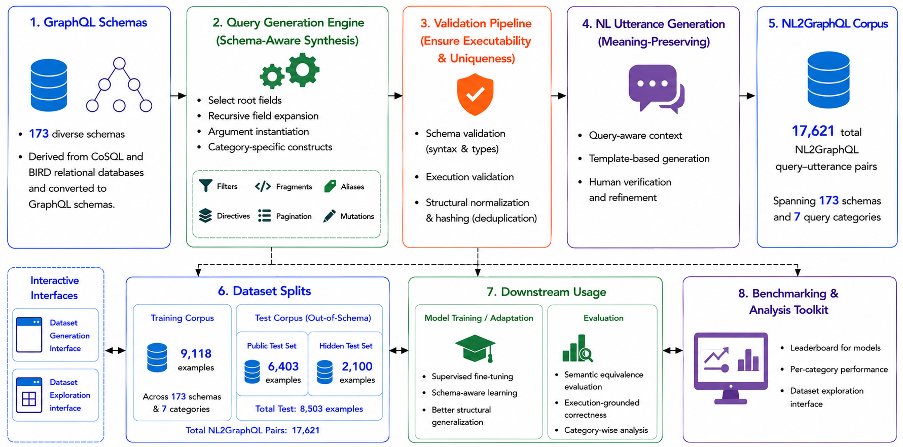

# AutoGraphQL

[](#)

AutoGraphQL is a systematic, schema-driven framework for synthesizing GraphQL query datasets directly from GraphQL SDL schemas. It supports a broad range of GraphQL constructs, including fragments, inline fragments, directives, filters, pagination, aliases, and mutations, enabling the automated creation of diverse, executable datasets for fine-tuning LLMs and adapting them to domain or enterprise-specific schemas.

Official implementation of our paper accepted at the **EMNLP 2026 Industry Track**.

**[Paper](docs/autographql.pdf) | [Leaderboard](https://nl2graphql-bench.github.io/) | [Datasets](https://github.com/nl2graphql-bench/datasets) | [Index](https://github.com/nl2graphql-bench/index)**

This is the **generation** component of NL2GraphQL Bench. The released
train and public-test splits it produced are in
[nl2graphql-bench/datasets](https://github.com/nl2graphql-bench/datasets);
[nl2graphql-bench/index](https://github.com/nl2graphql-bench/index) links
every component. Licensed MIT.

## At a Glance

- **17,621** NL2GraphQL instances
- **173** GraphQL schemas
- **7** query categories
- Schema-disjoint training, public-test, and hidden-test splits
- Automated schema and execution validation
- Support for complex GraphQL constructs
- Web interface for query generation and dataset creation

## Framework

AutoGraphQL takes a GraphQL SDL schema as input and systematically generates diverse GraphQL queries while enforcing schema validity and execution correctness. Generated queries can subsequently be paired with natural-language descriptions to construct NL2GraphQL datasets and evaluate language models.

<p align="center">
  
</p>

<p align="center">
  <em>Figure 1. Overview of the AutoGraphQL framework.</em>
</p>

The framework consists of the following main stages:

1. **Schema Processing**: parses and analyzes the input GraphQL SDL schema.
2. **Query Generation**: synthesizes queries across multiple GraphQL constructs and query categories.
3. **Validation**: checks generated queries for schema validity and executable correctness.
4. **Deduplication**: removes structurally redundant queries.
5. **Dataset Construction**: organizes validated queries into datasets for downstream NL2GraphQL research.

## Repository Structure

```
autographql/
├── pyproject.toml          # packaging: deps, extras, console script
├── src/autographql/        # the package
│   ├── query_generator_app.py   # GraphQLQueryGeneratorApp, the entry API
│   ├── cli.py                   # autographql-generate
│   ├── generators/              # one generator per query category
│   └── utils/                   # schema introspection, variable generation
├── schemas/                # GraphQL schemas used for generation
├── docs/
│   ├── autographql.pdf     # Paper
│   └── figures/
│       └── toolkit.png     # Framework overview
└── website/                # Dataset Generator and Dataset Explorer UI
```

## The interactive UI

`website/` is a FastAPI backend and a Next.js frontend serving two views:

- **Dataset Generator** — pick or upload `.graphql` schemas, choose categories,
  queries per category and max hops, then generate. Each query is validated
  against the schema and by executing it, and deduplicated by canonical hash.
- **Dataset Explorer** — browse what came out by split, schema and category, and
  inspect the natural-language utterance, the query, its variables and the
  schema side by side.

This is where validation happens: it is part of this framework rather than a
separate component.

## Install

```bash
pip install autographql
```

Add extras as needed: `autographql[datasets]` to write xlsx, `autographql[web]`
for the UI. To work on the code instead, clone the repo and `pip install -e
".[dev]"`.

## Use as a library

```python
from autographql import GraphQLQueryGeneratorApp
```

## Generate from the command line

```bash
autographql-generate --schema schemas/academic/index.graphql \
                     --category aliases --count 10 --max-hops 2
```

`--category` takes any of aliases, directives, external_fragments,
inline_fragments, filters, pagination, mutations, or `all`. Output is written to
`generated_queries/<schema>/`.

## Running the UI locally

### Backend

```bash
python3 -m venv venv
source venv/bin/activate
pip install -e ".[web,datasets]"
uvicorn website.backend.main:app --reload --port 8000
```

### Frontend

```bash
cd website/frontend
npm install
npm run dev
```

Open `http://localhost:3000`.

### CLI

```bash
source venv/bin/activate
autographql-generate --schema schemas/academic/index.graphql --category all --count 5
```

## Datasets

The training corpus (9118 NL2GraphQL instances) and the schema-disjoint public benchmark test set (6403 instances) are available for download at`datasets/`.

## Citation

Please cite the repo if you think our work is helpful to you.

```bibtex
@inproceedings{autographql2026,
  title={},
  author={},
  booktitle={},
  year={2026}
}
```

## License

MIT License

## Publishing

Releases publish themselves. `.github/workflows/publish.yml` uploads to PyPI
with Trusted Publishing (OIDC), so no API token is stored anywhere:

1. tag the commit, `git tag -s vX.Y.Z && git push origin vX.Y.Z`
2. create a GitHub release from that tag

The version comes from the tag via hatch-vcs, so there is no version to bump by
hand and a release cannot publish a number that disagrees with its tag.
